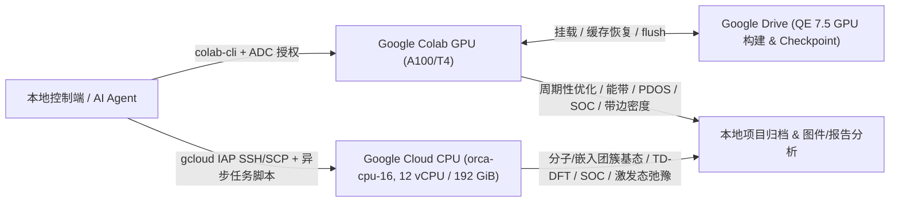

# Cloud CompChem Agent Prototype（云端双平台计算化学 Agent 自动化系统雏形）

本项目记录并整理了基于 AI Agent 协同调度 **Google Colab GPU（Quantum ESPRESSO 7.5）** 与 **Google Cloud Compute Engine CPU（ORCA 6.1.1）** 开展杂化金属卤化物发光晶体 DFT / TD-DFT 计算的早期系统探索、自动化脚本、计算输入/输出与方法学沉淀，用于后续持续学习并演进为个人可控的计算化学自动化工作流系统。

## 架构概览



## 仓库目录导航

| 路径 | 内容说明 |
|---|---|
| [`automation/`](automation/README.md) | 双平台远程调度脚本：`colab_project_cli.py`（自动弹页授权+长超时+JSONL 审计）、Colab QE GPU 编译与 Drive 恢复脚本、GCloud IAP SSH 批量作业管理模板 |
| [`systems/benzothiazolium_sncl6/`](systems/benzothiazolium_sncl6/README.md) | **体系二 `(C₇H₆NS)₂[SnCl₆]·2H₂O`**：双平台 Agent 后台自动化主项目（CIF 分析、任务清单、`QE_G01`–`QE_G05`、`ORC_C01`–`ORC_C03` 及其静电势诊断教训） |
| [`systems/phim_sncl6/`](systems/phim_sncl6/README.md) | **体系一 `(PhImH)₂[SnCl₆]·2H₂O`**：Colab A100 编译运行 QE 7.5 GPU 与 GCloud ORCA 阶段 2（已标记作废）/ 阶段 3（有效重算）全套脚本、数据与图件 |
| [`docs/`](docs/) | 从零开始的 Colab A100 + QE 教学、ORCA 量子化学与激发态分析全流程教学、文献方法对标报告与 Agent 执行说明 |
| [`.env.example`](.env.example) | 本地运行时所需环境变量模板（GCP 项目/实例/SSH 密钥路径、Colab 账号与 Drive 缓存路径） |
| [`.gitignore`](.gitignore) | 严格屏蔽私钥、ADC/OAuth 凭据、虚拟环境、`*.tar.gz`/`*.zip` 大归档及 `*.gbw`/`*.cube`/`*.wfc*` 等重型二进制产物 |

## 快速复用与安全说明

1. **隐私与安全脱敏**：
   - 仓库已剔除所有 SSH 私钥（`gcp_test_key*`）、Google ADC 凭据（`gcloud-auth/`）、`sessions.json`、`venv/`、以及超限压缩归档和大型波函数/网格二进制文件（如 `.cube`、`.gbw`、`.densities`、`charge-density.dat`）。
   - 代码与日志中的个人邮箱、GCP 项目 ID、本地盘符绝对路径已统一替换为 `<YOUR_...>` 占位符或环境变量读取方式。
2. **重新启用本地运行环境**：
   - 复制 `.env.example` 为 `.env` 并填入自己的 GCP 与 Colab 配置；
   - 按 `automation/colab_gpu/login_colab.cmd.example` 引导本地独立目录的 `google-colab-cli` ADC 授权；
   - 按 `automation/gcp_cpu/_common.ps1.example` 配置 `gcloud` 与短期 `--ssh-key-file` 后即可控制远端 CPU 实例。
3. **第三方软件与许可提示**：
   - Quantum ESPRESSO 遵循 GPL v2 协议；NVIDIA HPC SDK / CUDA 运行库受 NVIDIA EULA 约束，本仓库**不分发任何编译后的二进制与运行库**，仅保留构建与恢复脚本以供个人在 Colab 环境自建复现。

## 推送到 GitHub（`PC2005-cloud`）指南

本目录已初始化为独立的本地 Git 仓库（`main` 分支）。后续推送到 GitHub：

1. 在 GitHub（`https://github.com/new`）创建一个空仓库（例如 `cloud-compchem-agent`，建议先设为 Private 或按需设为 Public，**不要**勾选自动生成 README/.gitignore）；
2. 在本仓库根目录执行：
   ```powershell
   git remote add origin https://github.com/PC2005-cloud/<你的仓库名>.git
   git push -u origin main
   ```
3. 推送前可用 `git log --stat` 或 `git status` 再次确认无任何 `.env`、私钥或超大文件混入。
